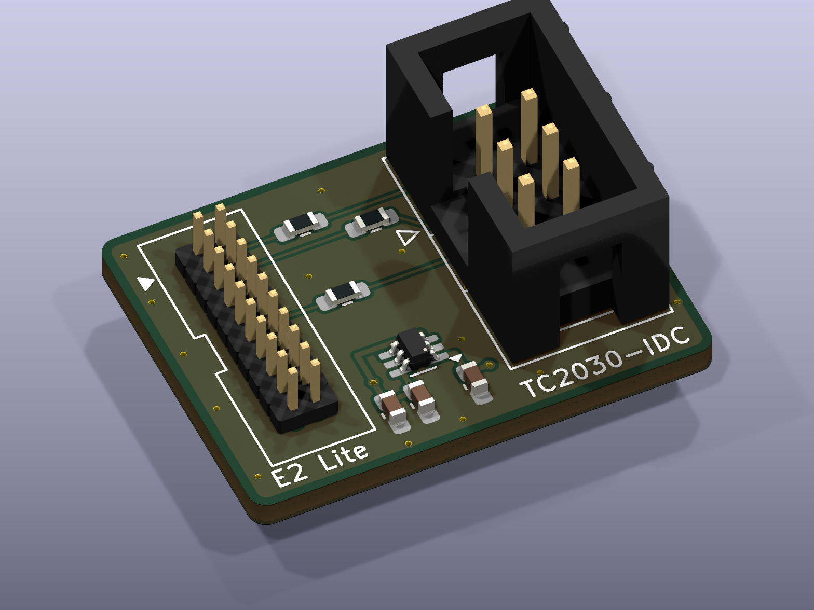
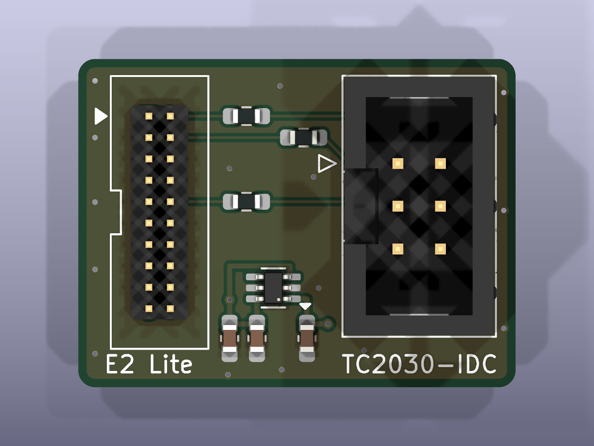
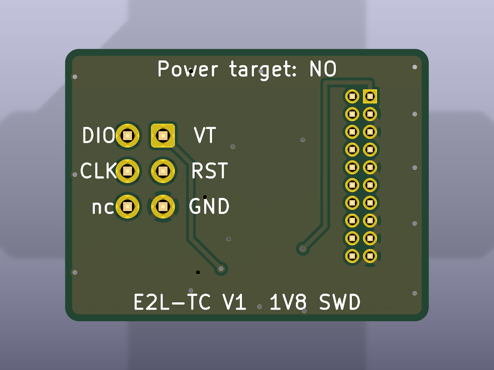

# Renesas E2 emulator Lite → Tag-Connect TC2030 adapter (hand-solder, open hardware)

A small, hand-solderable KiCad adapter board that connects a **Renesas E2 emulator Lite** (20-pin 1.27 mm debug connector, RA family / SWD) to a **Tag-Connect TC2030-IDC** cable, so you can program and debug Renesas RA MCUs through a TC2030 footprint (for example RA8, RA6, RA4) without a header on your board.



| Top | Bottom |
|---|---|
|  |  |

*Renders from KiCad. The 3D model of J1 is a plain pin header; the real part is a shrouded box header.*

**Status (November 2026):** design finished and checked (ERC 0, DRC 0 errors / 0 warnings / 0 unconnected / schematic parity 0, two independent reviews of every connection). Not built yet. Reports from builders are welcome via Issues.

Deutsch: [Kurzfassung unten](#deutsch).

---

## What it does

```
E2 Lite ── 20-pin 1.27 mm ribbon cable ── J1 [adapter] J2 ── TC2030-IDC cable ── TC2030 footprint on your board
```

| J1 (E2 Lite, 20-pin) | Signal | On the adapter | J2 / TC2030 | Target |
|---|---|---|---|---|
| 1 | VCC (target voltage reference) | U1 ideal diode (target → emulator) | 1 | VTref |
| 2 | SWDIO | R1 100 Ω | 2 | SWDIO |
| 4 | SWCLK | R2 100 Ω | 4 | SWCLK |
| 10 | RES# | R3 100 Ω | 3 | nRESET |
| 3, 5, 9 (UCON), 15, 17, 19 | GND | direct | 5 | GND |
| 6, 7, 8, 11–14, 16, 18, 20 | – | not connected | 6 (SWO) not connected | – |

- The J1 pinout follows the Renesas document *E2 Emulator, E2 Emulator Lite Additional Document for User's Manual (Notes on Connection of RA Devices)*, R20UT4686, Table 2.3 (SWD). **Pin 9 (UCON) must be tied to GND**, otherwise the E2 Lite does not detect the target.
- The J2 pinout is the common TC2030 SWD layout: 1 VTref, 2 SWDIO, 3 nRESET, 4 SWCLK, 5 GND, 6 SWO. With the TC2030-IDC cable, pin n of the footprint goes to pin n of the 2×3 IDC plug.
- The E2 Lite has no SWO trace input (pin 6 is a UART TxD on the E2 Lite), so SWO stays open.

## Protection (and its limits)

- **U1 LM66100 ideal diode** (CE tied to VOUT, ST to GND, as in TI's "always-on reverse current blocking" application). The E2 Lite powers its I/O buffers from the VCC pin (about 20 mA). Your board's supply reaches the emulator through U1 with only a few mV drop.
- **What U1 blocks:** target board **off** and the emulator set to supply 3.3 V by mistake. U1 blocks, so 3.3 V does not reach your target's rail.
- **What U1 does not block reliably:** target board **on** and the emulator supplying 3.3 V at the same time. U1 only switches off at several hundred mA reverse current; the E2 Lite supplies at most 200 mA.
- **R1–R3 (100 Ω)** damp the cable and limit the current if 3.3 V levels ever reach a 1.8 V target. That limits damage, it does not prevent it.
- **Always set "Power Target From The Emulator" to No** in e² studio / Renesas Flash Programmer when the target has its own supply. The bottom silkscreen says so as well.
- The E2 Lite works from 1.8 V to 5.5 V target voltage. The adapter costs a few mV, so a target running at exactly 1.8 V is right at the lower limit.

## Bill of materials

| Ref | Qty | Part | Notes |
|---|---|---|---|
| J1 | 1 | 2×10 box header, 1.27 mm pitch, straight, through-hole ("DC3-20P 1.27 mm") | notch towards the board edge (odd-pin side), as on the silkscreen |
| J2 | 1 | 2×3 box header, 2.54 mm pitch, straight, through-hole ("DC3-6P") | notch towards the middle of the board (odd-pin side), as on the silkscreen |
| U1 | 1 | TI LM66100DCKR, SC-70-6 | footprint has extended pads for hand soldering |
| R1, R2, R3 | 3 | 100 Ω, 0603 | |
| C1, C2 | 2 | 100 nF, 0603, X7R | |
| C3 | 1 | 1 µF, 0603 | 470 nF … 2.2 µF also fine |

You also need:
- a **20-pin 1.27 mm IDC ribbon cable** (both plugs in the same orientation, pin 1 to pin 1). The Renesas cable RTE0T00020KCAC0000J fits for sure.
- a **Tag-Connect TC2030-IDC** (with legs) or **TC2030-IDC-NL** (no legs) cable from [Tag-Connect](https://www.tag-connect.com/product/tc2030-idc-6-pin-tag-connect-plug-of-nails-spring-pin-cable-with-legs).
- a **Renesas E2 emulator Lite** (RTE0T0002LKCE00000R), for example from DigiKey or Mouser.

### Where to get the small parts (AliExpress, checked November 2026)

Listings change, so every part also has a description and search words. The links are examples, not recommendations of a particular seller. Check the variant (pitch and pin count) before you pay.

| Part | Example listing | Choose this variant | Search words if the link is dead |
|---|---|---|---|
| J1 and J2 box headers | [item 1005006195593825](https://de.aliexpress.com/item/1005006195593825.html) | **1.27 mm, 20P** and **2.54 mm, 6P**, straight (DIP) | `1.27mm box header 2x10 DC3 straight DIP`, `2.54mm box header 2x3 6P straight` |
| U1 LM66100DCKR | [item 1005013241477993](https://de.aliexpress.com/item/1005013241477993.html) | 10 pcs, SC-70-6 | `LM66100DCKR SC70-6` |
| 20-pin 1.27 mm cable (alternative to the Renesas cable) | [item 1005006165132728](https://de.aliexpress.com/item/1005006165132728.html) | **pitch 1.27 mm**, 20P, same direction | `1.27mm IDC flat cable 20 pin 2x10 same direction` |
| 0603 resistor and capacitor kits | any 0603 kit with 100 Ω, 100 nF and 1 µF | | `0603 resistor kit`, `0603 capacitor kit 1pF-10uF` |

Watch out: many "1.27 mm" ribbon cables have 2.54 mm plugs (the ribbon wires have a 1.27 mm pitch). For the E2 Lite you need **plugs with 1.27 mm pin pitch** (ribbon wire pitch 0.635 mm).

Pictures of the real parts: we do not copy seller photos (they belong to the sellers). The renders above show the footprints. Photos of an assembled board will be added once one is built.

## Ordering the PCB (JLCPCB or any other fab)

- Gerber files: [`fabrication/E2Lite_TC2030_Adapter_V1_gerbers.zip`](fabrication/E2Lite_TC2030_Adapter_V1_gerbers.zip)
- 2 layers, 26 × 19.5 mm, 1.6 mm FR-4, 1 oz copper, any colour, HASL (lead-free) or ENIG, tented vias, standard via size 0.3 mm (0.6 mm pad). No special options needed.

### Save money: add it to a PCB order you already have

If you work with Tag-Connect, you almost certainly have your own PCB in production anyway. Add the adapter as an extra design to that order (at JLCPCB: "Add new item" on the running order, or put both in the same cart). Everything then ships in one parcel.

Example from a JLCPCB quote on 4 November 2026 (5 pcs, shipping to Switzerland, prices in EUR, will change):

| | Board (5 pcs) | Shipping | Total |
|---|---|---|---|
| Ordered on its own | €3.66 (green HASL) … €4.64 (black, lead-free HASL) | €20.92 (DHL Express, 0.14 kg) | **€24.58 … €25.56** |
| Added to an order that ships anyway | €3.66 … €4.64 | about €0 (adds roughly 10 g) | **€3.66 … €4.64** |
| **You save** | | | **about €21 (≈ 82–85 %)** |

Shipping cost depends on your country, the carrier and the weight of the whole parcel. With JLCPCB the combined order only ships when every item in it is finished.

## Assembly (hand soldering)

1. **U1 first:** a little solder paste or flux, pin 1 (dot) at the silkscreen triangle. The pads are extended for a soldering iron.
2. **C1–C3, R1–R3** (0603, large pads).
3. **J1:** insert from the top, **notch on the outer edge (odd-pin side)** as on the silkscreen. The pins are 1.27 mm apart: use a fine tip and remove bridges with wick.
4. **J2:** notch towards the middle of the board, as on the silkscreen.
5. If U1 does not work (for example a bad part): remove it and bridge **pad 1 to pad 6** (same row, about 2 mm apart). VCC is then connected directly, as in Renesas' reference circuit, without the reverse-current protection.

## Check before first use (adapter alone, no target)

| From J1 | To J2 | Expected |
|---|---|---|
| 2 | 2 | ≈ 100 Ω |
| 4 | 4 | ≈ 100 Ω |
| 10 | 3 | ≈ 100 Ω |
| 3, 5, 9, 15, 17, 19 | 5 | 0 Ω |
| 1 | 1 | no short; diode test + at J2.1, − at J1.1: about 0.4–0.7 V (U1 body diode, estimate), reverse open |
| 1 vs 3 | 1 vs 5 | no short to GND |
| 6, 7, 8, 11–14, 16, 18, 20 | – | open |

Check the ribbon cable too: pin 1 must reach pin 1 at both ends (red wire).

### Power-up order (from the Renesas user manual)

1. Target off.
2. Connect adapter and cables.
3. Plug the E2 Lite into USB.
4. Start the debugger or flash tool, set "Power Target From The Emulator: No".
5. Switch the target on.
6. Connect in the software.

Reverse order when you finish. Do not unplug the E2 Lite's USB cable while the target is powered (Renesas warns about leakage currents).

## Files

```
hardware/      KiCad 10 project (schematic, PCB, footprints, 3D models from the KiCad library)
hardware/gen/  Python scripts that generate the schematic and the PCB (optional; macOS KiCad paths)
fabrication/   Gerber + drill files (zip)
images/        3D renders, schematic (PDF, SVG)
```

Custom footprints: `BoxHeader_2x10_P1.27mm_Vertical_DC3` (pins as KiCad `PinHeader_2x10_P1.27mm_Vertical`, drill 0.65 mm, assumed body 5.8 × 16.2 mm) and `SOT-363_SC-70-6_HandSolder` (KiCad pad positions, pads extended outwards).

## Related

- [ST-LINK V3 / ARM 20-pin → Tag-Connect TC2030 adapter](https://github.com/semmelrinde/stlink-v3-tag-connect-tc2030-adapter)

## Licence and disclaimer

- Hardware design, documentation and scripts: **CERN-OHL-P-2.0** ([LICENSE](LICENSE)). You may use, modify, make and sell it. The design comes without any warranty, see the licence.
- Footprints and 3D models taken from the KiCad libraries: CC-BY-SA 4.0 with the KiCad library exception, see [NOTICE.md](NOTICE.md).
- **Not affiliated with or endorsed by** Renesas Electronics, Tag-Connect LLC, Texas Instruments or any other manufacturer. Product names and trademarks belong to their owners and are used only to describe compatibility. No manufacturer datasheets, manual text or seller photos are included; please get them from the original sources.
- You use this adapter at your own risk. Check pinouts against your own board and debugger before connecting anything.

---

## Deutsch

Kleiner Adapter zum Selberlöten: **Renesas E2 emulator Lite** (20-polig, 1,27 mm) auf **Tag-Connect TC2030-IDC**. Damit programmierst und debuggst du Renesas-RA-Mikrocontroller über ein TC2030-Pad.

- **Belegung:** wie in der Tabelle oben. Pin 9 (UCON) liegt auf Masse.
- **Schutz:** Die Idealdiode LM66100 schützt nur bei ausgeschaltetem Zielboard vor den 3,3 V des Emulators. Darum im Programm immer „Power Target From The Emulator: No“ einstellen.
- **Teile:** zwei Wannenstecker (1,27 mm 2×10 und 2,54 mm 2×3), LM66100, drei 100-Ω-Widerstände, zwei 100-nF- und ein 1-µF-Kondensator, alle 0603. Links und Suchbegriffe stehen in der Tabelle.
- **Sparen:** Die Platine zu einer Leiterplattenbestellung dazulegen, die du sowieso hast. Dann fällt der eigene Versand weg, bei JLCPCB am 4.11.2026 etwa €21.
- Lizenz: CERN-OHL-P-2.0. Ohne Gewähr. Keine Verbindung zu Renesas oder Tag-Connect.
